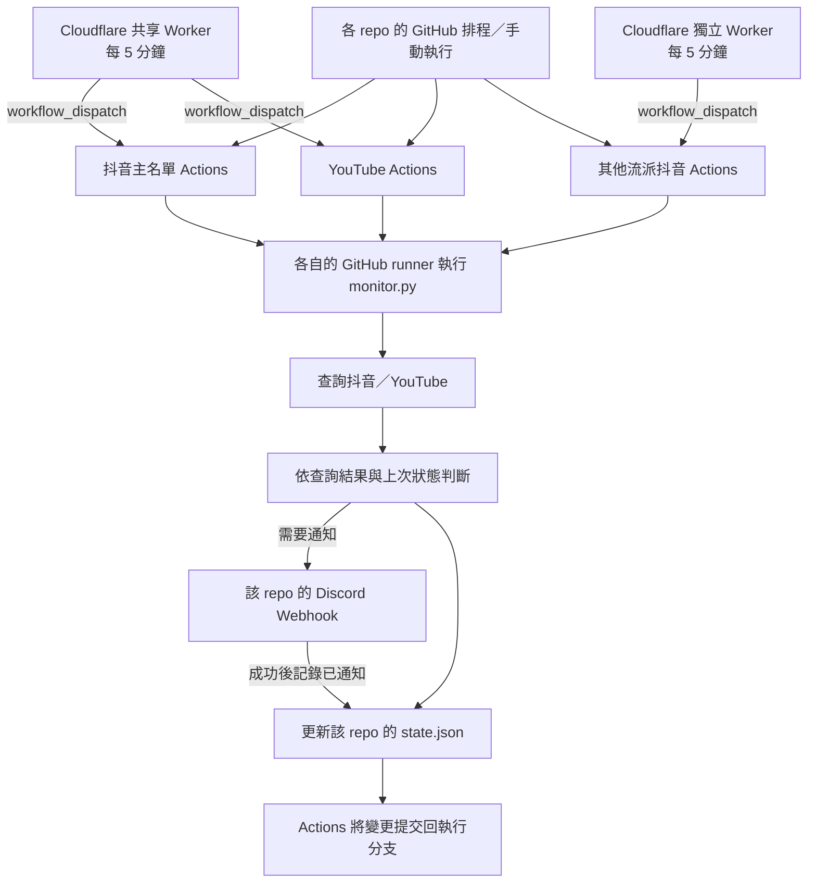

# 部署與維護交接

[回到 README](../README.md) · [本專案技術細節](TECHNICAL.md)

## 三個專案如何連動

三個 repo 各自執行監控、使用各自的 Secrets 與 `state.json`。抖音主名單與 YouTube 只共用 Cloudflare 排程器；它們不共用直播狀態，也不需要彼此的 Python 程式才能執行。

| Repo | 監測平台與名單 | 原作者的 Cloudflare Worker |
| --- | --- | --- |
| [douyin-live-notify](https://github.com/jordychen0512-byte/douyin-live-notify) | 抖音主名單，`monitor.py → STREAMERS` | `douyin-live-notify-scheduler`（共享） |
| [youtube-live-notify](https://github.com/jordychen0512-byte/youtube-live-notify) | YouTube，`channels.json` | 同上（共享） |
| [other-styles-douyin-live-notify](https://github.com/jordychen0512-byte/other-styles-douyin-live-notify) | 其他流派抖音名單，`monitor.py → STREAMERS` | `other-styles-douyin-live-notify-scheduler`（獨立） |



Cloudflare 只負責叫 GitHub 執行工作。查直播、發 Discord 通知和保存狀態都在 GitHub Actions 進行。抖音下播時也會更新狀態；YouTube 保存已通知影片 ID，不發下播通知。圖中三個 runner 是各自獨立的執行環境。

## 第一次使用：先讓單一 repo 跑起來

1. 選擇需要的 repo，Fork 到自己的帳號。先確認其授權說明；公開可見不等於已提供開源授權。
2. 在 Discord 伺服器設定的 **Integrations → Webhooks** 建立 Webhook，選擇接收通知的文字頻道，複製 URL。使用完整原始 URL，勿加上 `/github`；本專案會自行產生 Discord 訊息。詳見 [Discord 官方說明](https://support.discord.com/hc/en-us/articles/228383668-Intro-to-Webhooks)。
3. 在自己的 GitHub repo **Settings → Secrets and variables → Actions** 建立下表的 Repository secrets。Fork 不會自動取得原作者的 Secrets。
4. 修改監測名單。若這是全新的獨立部署，首次啟用前將自己的 `state.json` 重設為抖音的 `{}` 或 YouTube 的 `{"channels": {}}` 並提交；避免沿用原作者的通知記錄。接手原有服務則保留原狀態。
5. 開啟 **Actions** 並依 GitHub 提示啟用工作流程。公開 Fork 的排程預設停用；公開 repo 若 60 天沒有活動，也可能自動停用排程。詳見 [GitHub 啟用／停用說明](https://docs.github.com/en/actions/how-tos/manage-workflow-runs/disable-and-enable-workflows)。
6. 選擇 README 指定的 workflow，按 **Run workflow**，分支選 `main`（或你已設定的部署分支）。檢查平台查詢與狀態保存步驟的日誌。
7. 確認自動排程會再次執行，再依下一節決定是否加入 Cloudflare。

一般執行遇到正在直播且未記錄的主播，會實際發送 `@everyone`。YouTube 可先勾選 `test_notification` 驗證 Webhook；它不標註任何人、不查 YouTube、不更新狀態，只需 Webhook。兩個抖音專案目前沒有對應的測試模式。

| 設定位置 | 名稱 | 哪些專案需要 |
| --- | --- | --- |
| GitHub Repository secret | `DISCORD_WEBHOOK_URL` | 三個 repo 各自設定；可指向同一頻道或不同頻道 |
| GitHub Repository secret | `YOUTUBE_API_KEY` | 僅 YouTube；在自己的 Google Cloud 專案啟用 YouTube Data API v3 並建立 API key |
| GitHub Actions variable（選用） | `DISCORD_WEBHOOK_USERNAME` | 僅 YouTube；預設「YouTube 直播通知」，會覆寫 Webhook 原名 |
| GitHub Actions variable（選用） | `DISCORD_WEBHOOK_AVATAR_URL` | 僅 YouTube；未設定則沿用 Webhook 頭像 |
| Cloudflare Worker secret | `GITHUB_TOKEN` | 只有部署 Cloudflare 時需要；內容是自己的 PAT |

Actions 用來提交 `state.json` 的內建 `GITHUB_TOKEN` 由 GitHub 自動提供，workflow 已宣告 `contents: write`。它與 Cloudflare 裡同名的 PAT 是兩個不同來源，不需另建 GitHub Repository secret 來取代它。若儲存失敗，檢查分支規則、組織政策與執行日誌。

## 選擇排程方式

三個 repo 目前同時保留 GitHub 的 `schedule: */5 * * * *` 及 `workflow_dispatch`；Worker 的 Cron 也設定每 5 分鐘。這是觸發設定，不能保證五分鐘內收到通知。

- **只用 GitHub**：保留 workflow 原設定，不部署 Cloudflare；若已有 Worker，停止對應 Cron／移除該 repo 的 dispatch 目標。
- **只用 Cloudflare**：完成下節後，移除 workflow 的 `schedule` 區塊，保留 `workflow_dispatch`，並保持 workflow 啟用。不要用「Disable workflow」取代移除原生排程，否則外部也無法正常觸發。
- **兩者並用**：接受額外檢查、API 用量與 Actions 使用量。同一 repo 的 concurrency group 會限制同時執行，但不等於只執行一輪，也不提供通知恰好一次的保證。

## Fork 後部署自己的 Cloudflare Worker

先在 GitHub Actions 成功手動執行，再設定外部排程。部署前逐項修改 `scheduler/`：

| 檔案 | 必須檢查或修改的內容 |
| --- | --- |
| `src/index.js` | GitHub API URL 中的 owner `jordychen0512-byte` 改成自己的帳號／組織 |
| 共享版 `src/index.js` | `REPOSITORIES` 改成實際要觸發、已建立且已啟用的 repo；只 Fork 一個就只保留那一個 |
| 獨立版 `src/index.js` | `GITHUB_API_URL` 中的 repo 名稱改成自己的目標 |
| `src/index.js` | `ref: "main"` 改成實際執行分支；若改 workflow 檔名，也要改 URL 中的 `check-live.yml` |
| `wrangler.jsonc` | `name` 改成自己帳號內要使用的 Worker 名稱，確認 Cron 設定 |

共享版的程式同時放在抖音主名單與 YouTube repo。使用同一 Cloudflare 帳號及同一 Worker 名稱部署任一份，都會更新同一個 Worker。選定一份作為部署來源；修改時同步另一份，避免下次部署覆蓋目標清單。只新增 YouTube 時，也不要遺失既有抖音目標。

在 GitHub **Settings → Developer settings → Personal access tokens → Fine-grained tokens** 建立 PAT，Repository access 只選目標 repo，Repository permissions 的 **Actions** 設為 **Read and write**。共享 Worker 同時觸發兩個 repo 時，token 必須涵蓋兩個；獨立 Worker 只需其目標。記錄到期日並安排更新。權限依據：[GitHub workflow dispatch API](https://docs.github.com/en/rest/actions/workflows#create-a-workflow-dispatch-event)。

本機需有 Node.js／npm，並已登入正確 Cloudflare 帳號。在選定 repo 的 `scheduler/` 目錄依序執行：

```sh
npx wrangler login
npx wrangler secret put GITHUB_TOKEN
npx wrangler deploy
```

第二個指令會互動式要求輸入 PAT；不要把 token 寫進程式或文件。Wrangler 若提示 Worker 尚未建立，先建立設定中指定的 Worker，再完成 secret 與部署。

到 Cloudflare Worker 的 Cron 設定與日誌確認觸發，再到 GitHub Actions 確認出現對應執行。GitHub dispatch 成功只代表接受觸發請求；仍要檢查 Actions 內部是否成功。Cron 使用 UTC，變更最多可能需要約 15 分鐘傳播，參考 [Cloudflare 官方說明](https://developers.cloudflare.com/workers/configuration/cron-triggers/)。

## 日常維護與交接

| 要做的事 | 操作與確認 |
| --- | --- |
| 增減主播 | 抖音修改 `STREAMERS`；YouTube 修改 `channels.json`，查詢依據是固定 `channel_id`，不是 handle。新項目通常由程式建立狀態，無需清空其他人的記錄。 |
| 換 Discord 頻道 | 建立／調整目標 Webhook，更新各相關 repo 的 `DISCORD_WEBHOOK_URL`。YouTube 可用測試模式驗證。 |
| 更新 PAT | 在到期前建立替代 token，確認 repo 範圍與 Actions 寫入權限，對每個使用它的 Worker 執行 `npx wrangler secret put GITHUB_TOKEN`；確認下一次 Cron 成功後再撤銷舊 token。 |
| 更換維護者 | 交接 GitHub repo、Cloudflare Worker、Discord 頻道與 Webhook 的管理權限；YouTube 另交接 Google Cloud 專案。以新維護者憑證更新 Secrets，再驗證全流程。 |
| 暫停單一服務 | 在該 repo 的 Actions 停用 workflow，確認已排隊／執行中的工作；需要立即停止時取消它們。同時移除 Worker 對該 repo 的目標並部署，或停止其專用 Cron。共享 Worker 的另一個目標應保留。 |
| 恢復服務 | 確認 Secrets／PAT 有效，啟用 workflow，恢復所需排程，手動跑一次並查看下一次自動執行。保留原 `state.json` 可延續去重記錄。 |
| 換 repo／改名／換分支 | 更新 Worker 的 owner、repo、ref、workflow URL 與 PAT 範圍；同步兩份共享 Worker 原始碼。 |

不要把定期清空 `state.json` 當成保養方式。重設可能補送目前直播；狀態保存失敗或網路回應不確定也可能重複通知。兩個抖音專案依布林狀態去重，檢查間隔內下播又重開可能漏掉新一場；YouTube 只檢查最近 15 筆 uploads 並保留每頻道最近 100 個通知 ID。

交接時另外保存一份內部清單：GitHub owner／repo／分支、Worker 名稱與部署來源、採用哪些排程、PAT 到期日、Discord 接收頻道，以及各服務管理者。只記錄位置和負責人，勿放入 secret 值。

## 排錯：按資料流查

| 現象 | 先檢查 |
| --- | --- |
| 沒有新的 Actions 執行 | workflow 是否啟用、GitHub 排程是否仍存在；若用 Cloudflare，查看 Cron 與 Worker 日誌、PAT 到期日和目標 URL。 |
| Worker 回 401／403／404／422 | token 是否有效及可存取目標 repo、Actions 寫入權限、owner／repo／workflow 檔名／ref 是否正確；HTTP 狀態只是線索，以日誌為準。 |
| Actions 綠色但沒收到通知 | 主播是否符合通知條件、是否已在 state 中；兩個抖音程式會捕捉單一主播錯誤，綠色不代表所有查詢成功，須閱讀日誌。 |
| YouTube API 失敗 | 是否啟用 Data API v3、API key／限制是否正確、配額與錯誤內容；先以測試模式區分 Webhook 與 YouTube 問題。 |
| 重複通知 | `state.json` 是否被清空、狀態提交／推送是否失敗、是否從不同分支或另一份部署發送到同一頻道。 |
| 狀態提交失敗 | 分支保護／Rulesets、token 政策、rebase 衝突；確認通知可能已送出，勿直接刪除 state。 |
| 抖音查詢失敗或超時 | 平台回應、`streamget` 與 Node 安裝日誌；查看本 repo 的重試規則，不要假設兩個抖音專案實作相同。 |

此文件描述程式庫內的設定；實際 Cloudflare 部署、帳號權限、Secrets 有效性與 Discord 接收結果，仍需由維護者在各服務確認。

